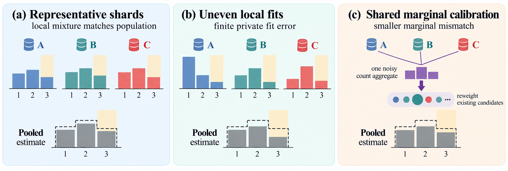
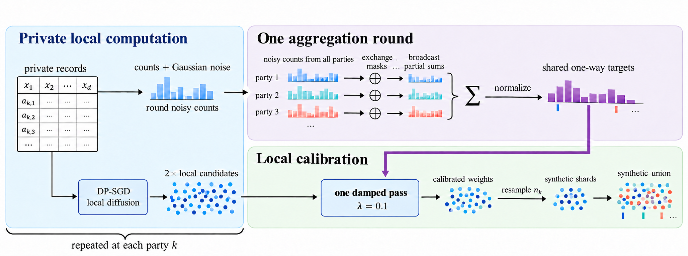
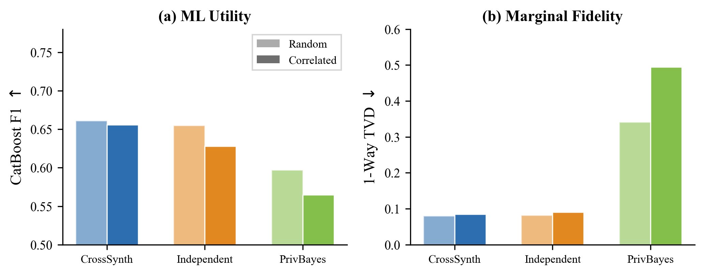

# CrossSynth

**When sites train generators on uneven shards, the synthetic union can keep the counts and still miss the joints.**

CrossSynth is a federated tabular synthesizer. Each party trains a local diffusion model under differential privacy. One synchronization round securely aggregates a noisy vector of one-way counts. Parties then draw an enlarged candidate pool and apply one damped calibration pass against that release. Generator weights stay local. Communication follows the marginal vector, not the model size.

<p align="center">
  <a href="#quick-start"><strong>Quick start</strong></a>
  &nbsp;·&nbsp;
  <a href="#reproduce-the-tables"><strong>Reproduce</strong></a>
  &nbsp;·&nbsp;
  <a href="#layout"><strong>Layout</strong></a>
</p>

## When the shared signal matters

Independent private models on heterogeneous catchments can agree on simple population counts and still disagree on relationships that matter downstream. CrossSynth spends one private count release on that gap.

<p align="center">
  
</p>

## One aggregation round

Parties exchange additive masks, then broadcast partial sums. The server sees only the summed noisy count vector. Each site conditions generation and one weak one-way reweighting pass on that aggregate.

<p align="center">
  
</p>

## Random vs correlated partitions

Under random shards the shared signal is less necessary. Under correlated catchments, calibration against the released aggregate improves utility relative to matched constant, random, and absent controls.

<p align="center">
  
</p>

## Quick start

Python 3.10+ recommended.

```bash
pip install -r requirements.txt
python run_experiments.py --quick
```

`torch` and `opacus` are required for the paper profile. Datasets download through OpenML where applicable.

## Reproduce the tables

Manuscript protocol (`paper` profile: count-space release, integer rounding, in-process secure sum, Opacus training, damped one-way calibration):

```bash
python run_experiments.py --profile paper
```

Conditioning / marginal-set / budget sweeps:

```bash
python run_revision_ablations.py --profile paper --seeds 3 --epochs 100
```

Filter examples:

```bash
python run_experiments.py --profile paper --dataset adult --method fedsynth
python run_experiments.py --profile paper --partition correlated --seeds 3 --epochs 100
python run_experiments.py --profile paper --method fedavg_8bit --partition correlated
python run_experiments.py --quick --profile legacy
```

Outputs go under `results/` (gitignored). Runtime depends on GPU/CPU, seeds, and datasets.

```bash
python run_experiments.py --help
python run_revision_ablations.py --help
```

## Layout

```
run_experiments.py           CLI grid, protocol profiles, metrics aggregation
run_revision_ablations.py    conditioning, marginal-set, and budget-split sweeps
synthesizer.py               CrossSynth, FedAvg variants, independent/central diffusion
marginals.py                 count queries, Gaussian release, additive-share sum
datasets.py                  OpenML loaders and partition protocols
metrics.py                   utility, TVD, association error, conditional F1
benchmark_config.py          shared hyperparameters and grids
tests/                       count-sensitivity and secure-sum checks
docs/figures/                figures used in this README
```

## Notes

- The CLI default is the `paper` profile. `--profile legacy` is a different protocol (probability-space noise, no calibration) and must not be mixed into the same result table.
- Calibration is one damped pass (`0.1`, clip `[0.1, 10]`) on a two-times candidate pool. It uses the released one-way marginals only.
- `cond_mode` selects a real marginal target or a same-shape constant, random, or absent control. Under `paper`, that target feeds both the fixed network input and the calibration pass.
- Count-vector sensitivity is replace-one in count space and does not scale with shard length. A published synthetic table can still reveal each shard's output length.
- No proprietary datasets are bundled. OpenML downloads go to the local sklearn cache.
